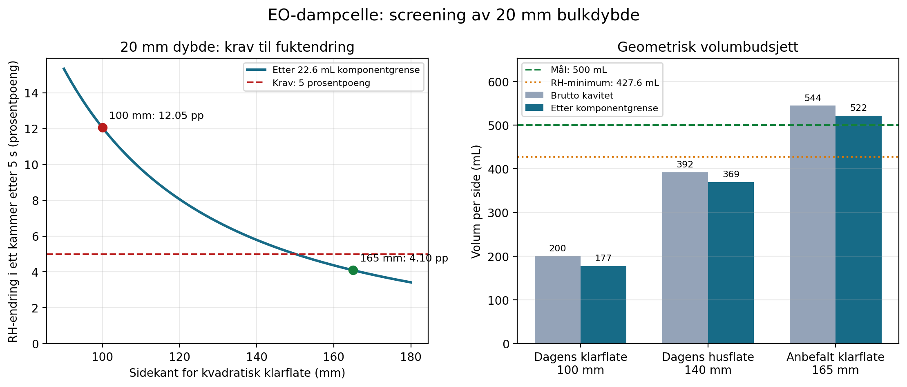

# Test av 20 mm kanaldybde for EO-dampcellen

Status: post-V10 engineering sensitivity. Den publiserte V10-utgivelsen og handoff-v1 er uendret.

## Tolkning og hovedresultat

20 mm er her tolket som bulk kammerdybde på hver side av membranen. Det lokale membrangapet forblir 2 mm. Med dagens 100 x 100 mm klare kammerflate blir bruttovolumet bare **200.0 mL per side**. Selv uten installerte komponenter er dette under det beregnede minimumet på **427.56 mL** og langt under målet 500.0 +/- 5.0 mL.

Ved 200 mL gir den samme 208 g/m2/h-fluksen og det samme 5 s-segmentet:

- RH-endring per kammer: **10.689 prosentpoeng**;
- RH etter 5 s: **39.311% i A og 60.689% i B**;
- stivt kammer, differansetrykkdiagnostikk: **1017.1 Pa**;
- for å holde 5 prosentpoeng: segmentet må ned til **2.339 s**, frekvensen opp til minst **0.2138 Hz**, eller fluksen ned til **97.30 g/m2/h**.

Den anbefalte 20 mm-løsningen er derfor en **165 x 165 x 20 mm klar kavitet** per side, ikke 100 x 100 x 20 mm. Den gir 544.5 mL brutto. Etter et konservativt komponentbudsjett på 22.6 mL gjenstår 521.9 mL. Bruk modulære kalibreringsinnsatser med kapasitet fra 21.9 til 44.5 mL per side; 21.9 mL er startverdien ved konservativ komponentgrense. Trim hver ferdigmonterte side til 500.0 +/- 5.0 mL ved måling.

En kvadratisk 20 mm-kavitet trenger minst 158.11 mm side uten maskinvare, 161.65 mm med det konservative komponentbudsjettet, og 150.03 mm for bare å møte RH-grensen. Ved 100 x 100 mm måtte dybden vært minst 52.3 mm for 500 mL med samme budsjett.

## Scenarioresultater

| Scenario | Brutto mL | Netto mL | RH-endring pp | Delta p Pa | 5 pp-krav |
| --- | --- | --- | --- | --- | --- |
| 100x100x20_geometry_only | 200.0 | 200.0 | 10.689 | 1017.1 | FAIL |
| 100x100x20_with_conservative_component_bound | 200.0 | 177.4 | 12.051 | 1146.7 | FAIL |
| 165x165x20_before_calibration_trim | 544.5 | 521.9 | 4.096 | 389.8 | PASS |
| 165x165x20_calibrated_to_500ml | 544.5 | 500.0 | 4.276 | 406.9 | PASS |

## Alternative måter å beholde 100 mm klarflate

Det finnes to reelle alternativer til den anbefalte 165 mm-flaten:

1. Legg til minst **322.6 mL eksternt volum per side**. Styrken er at selve cellen forblir kompakt. Svakheten er ekstra slange-/plenumvolum, fuktopptak på flere flater og blandeforsinkelse i en test som bare varer fem sekunder per segment.
2. Bruk den konservative installerte øvre grensen på **177.4 mL** og endre protokollen til høyst **2.075 s** per halvsyklus, minst **0.2410 Hz**, eller høyst **86.30 g/m2/h**. Styrken er enkel mekanikk. Svakheten er at forsøket ikke lenger tester den opprinnelige 5 s / 208 g/m2/h-basen, og sensoren blir for treg i forhold til dynamikken.

## Designporter som kan beregnes eller avgrenses

Ingen fysisk designport er markert lukket fra en skrivebordsberegning. Tabellen skiller en beregnet startverdi fra målingen eller inspeksjonen som fortsatt kreves.

| Designport | Skrivebordsstatus | Anbefalt valg | Styrke | Svakhet | Gjenstår |
| --- | --- | --- | --- | --- | --- |
| Bruttovolum og kammerdybde | calculated design selected | Bruk 165 x 165 x 20 mm klar kavitet per side; 544,5 mL brutto. | Beholder ønsket dybde på 20 mm og gir kalibreringsmargin. | Gir et bredt, grunt kammer og øker ytterplaten til omtrent 205 mm kvadrat. | Frigi CAD og kontroller de maskinerte kavitetsmålene. |
| Fortrengning fra installerte komponenter | conservative upper bound | Reserver 22.6 mL per side ved å bruke komponentenes fulle avgrensningsvolumer. | Konservativt tidlig volumbudsjett; faktisk fast fortrengning bør bli mindre. | Viftevolumet inneholder luft og er derfor ikke en kalibrert fortrengningsverdi. | Mål hver installert del med CAD/nedsenking og kalibrer det monterte kammeret. |
| Dimensjonering av endevegg og midtskille | uniform pressure component screened | Behold 12 mm lastplater i 6082-T6 aluminium og minst 16 mm ufylt PEEK-isolasjon; beregnet trykkdeformasjon i aluminium er 1.33 µm ved 5 kPa. | Den jevne gasstrykk-komponenten gir liten beregnet deformasjon og spenning. | Beregningen utelater punktlaster fra bolter, tetningskraft, hull, PEEK-kryp og temperaturgradienter. | Kontroller endelig CAD/FEA og mål deformasjon under last. |
| Fluidiske og elektriske gjennomføringer | idealized wall bore screen only | Prøv to 316-rustfrie 6 mm OD-bulkheadkoblinger med 4 mm strømningsvei per side og en avtakbar hermetisk seks-pins gjennomføring. Header, trykktapp og to ideelle 4 x 8 mm veggboringer summerer til 0.971 mL og etterlater bare 0.329 mL av 1,3 mL-budsjettet. | Standardiserte, gjenbrukbare komponentkandidater og en liten idealisert veggboregeometri. | Screeningen utelater faktisk indre volum i koblinger, rør og isolasjonsventiler; den dokumenterer derfor ikke at 1,3 mL-grensen består. | Mål eller hent CAD-volum helt frem til stengte ventiler, frigi grensesnitttegninger og utfør trykkfall- og krysslekkasjetest. |
| Innvendig vifte og innfesting | catalogue screen only | Prøv én NF-A4x10 5V PWM-vifte per side, innfelt eller kantmontert. Ideell volumomsetning er 0.20 s og 20%-skjermen gir 1.01 s. | Passer innen 20 mm dybde, har PWM-styring og god katalogluftmengde. | V/Q er ikke blandetid. Maksimal statisk viftetrykk er 19.1 Pa mot 5 Pa-målet, og maksimal katalogeffekt gir en gas-only øvre temperaturgrense på 3.0 K. | Mål temperaturbias, faktisk fortrengning, strømning og vibrasjon i begge kamre. |
| Baffelgeometri og innfesting | starting geometry proposed | Bruk avtakbare 1 mm PEEK-vende-/fordelerskovler, minst 60% åpne og maksimalt 2 mL fastvolum per side. | Lite volumtap og enkel iterasjon mot dødsoner. | Åpningsgrad beviser ikke jevn blanding og kan gi lokalt trykkfall. | Frigi CAD etter sporstoff- eller rask fuktkartlegging. |
| Differansetrykkhåndtering | required compliance calculated | Bruk enten to eksternrefererte gasstette diafragmaer med minst +/-992 µL vandring, 1.98 mL fullt slag og 0.397 mL/Pa hver, eller én dobbeltvirkende med samme slag og 0.198 mL/Pa mot differansetrykket. | Utjevner trykk uten direkte blanding av de fuktige gassinventarene. | Friksjon, fjærstivhet, hysterese og permeasjon kan dominere ved bare 5 Pa. | Kjør hele ABBA-sekvensen med kalibrert differansetrykksensor. |
| Boltmønster og forspenning | pressure separation only screen | Bruk 16 x M5 A4-skruer med omtrent 45-50 mm perifer avstand, harde kompresjonsstopp og skivefjærer; 1,0 Nm gir omtrent 1000 N nominelt per skrue ved K=0,2. | Nominell samlet forspenning er omtrent 118 ganger den rene separasjonskraften fra 5 kPa. | Spredning mellom moment og forspenning samt PEEK-kryp gjør moment alene uegnet som gapkontroll. | Definer boltmønster, kryssvis tiltrekking og kontroller last/gap etter holdetid. |
| Tetningsgeometri og kompresjon | gland starting dimensions calculated | Prøv to kontinuerlige 2 mm EPDM 70-plantetninger ved 25% nominell klem: 1,50 mm spordybde og 2,90 mm bredde (72.2% nominell fylling), adskilt av guardsporet. Spesifiser gasstetningsflaten som Rq/RMS <= 0.4 µm, ikke Ra. | Dobbel tetning gir målbar guard-lekkasje; bredere spor har 77.4% fylling selv ved screenet 1,40 mm effektiv dybde. | Diameter-/sportoleranse, hjørnevolum, svelling, kompresjonssett og permeasjon er fortsatt ikke fullstendig toleransestablet. | Bekreft leverandørens toleranser og kompatibilitet, gjør full gland-stack og utfør lekkasje-/blanktest med harde stopp. |
| Datumer og måltoleranser | starting scheme defined | Datum A på membran-/tetningsplanet, B/C på ortogonale senterplan; 20,00 +/- 0,05 mm dybde, 0,05 mm planhet/parallellitet og +/-0,05 mm lokale gap. | Gir en inspiserbar og symmetrisk stakkdefinisjon. | Toleransene øker maskineringskostnaden og er ikke avstemt mot valgt leverandørprosess. | Frigi tegningen og gjennomfør CMM-/planhetskontroll. |
| Planhet og gap under last | pressure component screened | Bruk harde gapstopp og kartlegg lastede 1/2/4 mm-innsatser; trykkdeformasjonen i aluminium ved 5 kPa er 1.33 µm mot foreslått 50 µm planhetsgrense. | Jevnt trykk alene er neglisjerbart sammenlignet med den foreslåtte toleransen. | Tetning og diskrete boltlaster, ikke gasstrykket, vil trolig styre virkelig deformasjon. | Kartlegg montert gap under driftsforspenning og etter krypholdetid. |
| Intern blandetid | flow capacity screen only | Bruk symmetrisk kontinuerlig PWM-blanding og verifiser romlig trinnrespons med en raskere referanse enn SHT45. | Katalogluftmengden tilsvarer 1.01 s per kammervolum selv ved 20% effektivitet. | SHT45 har tau63 på 4.0 s, nesten hele 5 s-segmentet, og kan ikke alene bevise den modellerte 0,1 s-transienten. | Mål blandetid på flere posisjoner med rask dampanalysator eller validert sporstoffmetode. |
| Kalibrering av nettovolum | trim range designed not measured | Maskiner 544,5 mL brutto og bruk modulære PEEK-innsatser som dekker 21.9-44.5 mL per side; 21.9 mL er startverdien ved konservativ komponentgrense. | Avtakbar trim gjør 500,0 +/- 5,0 mL oppnåelig til tross for komponentusikkerhet. | Nominell startinnsats følger en konservativ komponentgrense; mindre faktisk fastvolum krever opptil 44,5 mL innsats. | Kalibrer hver forseglet montert side sporbar i driftskonfigurasjon. |

## Mekanisk skjermberegning

Plateskjermen bruker 5 kPa prøvedifferanse over hele den 165 mm klare flaten, omtrent 12 ganger den stive 500 mL-diagnostikken. Dette er en lineær, enkelt opplagt kvadratplateskjerm og ikke en slutt-FOA/FEA.

| Material | Thickness mm | Pressure deflection um | Bending stress MPa |
| --- | --- | --- | --- |
| EN AW-6082-T6 aluminium | 12 | 1.330 | 0.278 |
| Unfilled PEEK | 16 | 8.816 | 0.165 |

Den beregnede trykkseparasjonskraften ved 5 kPa er 136.1 N. 16 M5-skruer ved 1.0 Nm gir omtrent 1000 N nominell forspenning per skrue med mutterfaktor 0.2. Dette er et styrkesjekkpunkt, ikke en presis forspenningsgaranti; hardstopp og kontroll av lastet gap skal styre tetningskompresjonen.

For to 2 mm EPDM-tetninger ved 25% nominell klem blir startverdien 1.50 mm spordybde og 2.90 mm bredde, tilsvarende 72.2% nominell gland fill. Ved den screenede minimumsdybden 1.40 mm blir dybdebidraget alene 77.4% fylling og 30% klem. Diameter-/sportoleranse, hjørnevolum og svelling må fortsatt legges til. Parkers gasstetningsverdi føres som Rq/RMS <= 0.4 µm, ikke som Ra.

## Trykk, blanding og måling

Den stive 500 mL-modellen gir 406.9 Pa mellom kamrene etter 5 s. For å holde differansen nær 5 Pa trengs omtrent **+/-0.992 mL** vandring per side og minst **1.983 mL fullt slag**. To separate diafragmaer mot samme eksterne referanse trenger hver omtrent **0.397 mL/Pa** over +/-2,5 Pa. Ett dobbeltvirkende diafragma trenger omtrent **0.198 mL/Pa** definert mot hele 5 Pa-differansen. Begge er bedre enn en gassforbindelse mellom kamrene; en direkte forbindelse vil blande fukt og ødelegge inventarbalansen.

Den foreslåtte 40 x 40 x 11 mm PWM-viften har 8.9 m3/h katalogstrøm. Fri-blås V/Q tilsvarer 0.202 s, og en antatt 20%-faktor gir 1.011 s. Dette er bare kapasitetshypoteser, ikke beregnet blandetid. Maksimalt statisk trykk er 19.1 Pa, større enn 5 Pa-målet, så vifte/baffel og trykktapp må prøves sammen. Varme er også en svakhet: 0.30 W typisk effekt gir 2.58 K, mens 0.35 W maksimal katalogeffekt gir en gas-only, adiabatisk femsekunders øvre grense på 3.01 K. Bruk like vifter kontinuerlig på begge sider etter termisk stabilisering, og mål temperaturbias.

SHT45 kan screene en cirka 4.3 prosentpoeng endepunktsendring, men den typiske +/-1 prosentpoeng-nøyaktigheten er omtrent 23% av signalet per avlesning og oppgitt tau63 er 4 s. Den kan derfor ikke alene gi en presis transient eller dokumentere 0.1 s-sampling og sub-segment blanding. Bruk den til endepunkt/quasi-statisk kontroll og en raskere referanse for blandingstesten.

## Dersom 20 mm egentlig betyr lokalt membrangap

Dette er ikke det valgte tilfellet, men følsomheten er beregnet. Lokalt volum øker fra 5.0 til 50.0 mL per side, mens resterende bulkvolum ved 500 mL faller til 450.0 mL. Ved 1 m/s øker kanalstrømmen fra 6.0 til 60.0 L/min. En hydraulisk-diameter-screen gir Dh=28.57 mm, Re=1767 og k=0.00716 m/s ved 20 mm, mot k=0.05316 m/s ved 2 mm. Fordi 20 mm-kanalens bredde/gap bare er 2.5, og én vegg er aktiv mens den andre ikke er det, er Sherwood-randbetingelsen ikke validert; koeffisienten er kun en screeningverdi. Selve headeren blir 7.5 mL og overskrider alene 1.3 mL-budsjettet, så feilen er uavhengig av ukjent fittingvolum. Et lokalt 20 mm-gap trenger derfor en egen transport- og headerdesign.

## Begrensninger

- Komponentbudsjettet bruker hele fanens bounding box og er konservativt; faktisk solidvolum må måles.
- Plateskjermen inkluderer ikke bolthull, punktlaster, tetningskraft, kryp, termiske gradienter eller den endelige randbetingelsen.
- Katalogluftmengde er ikke lik blandingstid i den grunne cellen.
- Sensorrespons, diafragmastivhet, lekkasje, overflateadsorpsjon og montert volum kan bare lukkes eksperimentelt.
- 165 mm-flaten kan gi større laterale fuktgradienter enn den gamle 100 mm-flaten; baffle og sensorer må derfor valideres ved flere posisjoner.

## Primærkilder for foreslåtte valg

- [Hydro EN AW-6082 technical datasheet](https://www.hydro.com/Document/Index?id=7824&name=Hydro+EN+AW+6082.PDF): 70 GPa aluminium elastic modulus.
- [Ensinger TECAPEEK natural material data](https://www.ensingerplastics.com/en-gb/shapes/peek-tecapeek-natural): 4.2 GPa unfilled-PEEK elastic/flexural modulus.
- [Parker O-Ring Handbook ORD 5700](https://www.parker.com/content/dam/Parker-com/Literature/O-Ring-Division-Literature/ORD-5700.pdf): Static face-seal design, gas-seal surface finish and EPDM screening.
- [Noctua NF-A4x10 5V PWM specifications](https://www.noctua.at/en/products/nf-a4x10-5v-pwm/specifications): Fan size, airflow and input power.
- [Sensirion SHT45 specifications](https://sensirion.com/products/catalog/SHT45): Humidity accuracy and response-time limitation.
- [Swagelok SS-6M0-61 6 mm bulkhead union specifications](https://products.swagelok.com/en/c/straights/p/SS-6M0-61): 316 stainless 6 mm-OD bulkhead fitting choice.

## Reproduksjon

Kjør:

    python3 scripts/analyze_eo_vapor_test_cell_20mm.py
    python3 -m pytest -q tests/test_eo_vapor_test_cell_20mm_study.py

Maskinlesbare resultater, audit og kildehasher ligger i samme mappe som denne rapporten.
