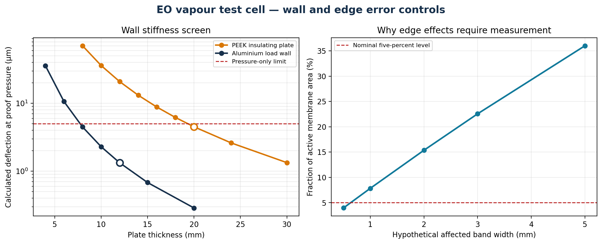

# EO vapour test cell — error-controlled design basis

Status: **build basis, not fabrication release**. Known errors are calculated where possible and converted into physical acceptance tests where calculation alone is not credible.

## Construction selected

- Outer structural/load walls: **12 mm EN AW-6082-T6 aluminium**. Calculated pressure-only deflection is 1.330 µm at the 5 kPa proof screen; the calculated thickness needed for the 5 µm criterion is 7.72 mm.
- Electrically insulating cartridge plate: **20 mm unfilled PEEK**. Calculated pressure-only deflection is 4.514 µm; the calculated 5 µm minimum is 19.33 mm.
- Local membrane gap: **2.00 ± 0.02 mm under operating preload**, controlled by hard stops and verified after assembly.
- Wetted bulk walls: structural aluminium outside the gas boundary with a removable, smooth non-porous metal liner. Exposed PEEK is confined to the necessary insulating cartridge land.
- Sealing: two continuous 2 mm EPDM 70 Shore A face seals, 25% nominal squeeze, separated by a vented and monitored guard groove.

The uniform-pressure calculation does not close the bolt/seal load case. Final CAD/FEA and a loaded gap map remain mandatory because discrete fastener loads, seal compression and PEEK creep can dominate the gas-pressure deflection.

## Plate screen

| Material | Thickness (mm) | Deflection (µm) | Gap fraction (%) | Decision |
| --- | ---: | ---: | ---: | --- |
| EN AW-6082-T6 aluminium | 4 | 35.914 | 1.796 |  |
| EN AW-6082-T6 aluminium | 6 | 10.641 | 0.532 |  |
| EN AW-6082-T6 aluminium | 8 | 4.489 | 0.224 |  |
| EN AW-6082-T6 aluminium | 10 | 2.298 | 0.115 |  |
| EN AW-6082-T6 aluminium | 12 | 1.330 | 0.067 | selected |
| EN AW-6082-T6 aluminium | 15 | 0.681 | 0.034 |  |
| EN AW-6082-T6 aluminium | 20 | 0.287 | 0.014 |  |
| Unfilled PEEK | 8 | 70.530 | 3.526 |  |
| Unfilled PEEK | 10 | 36.111 | 1.806 |  |
| Unfilled PEEK | 12 | 20.898 | 1.045 |  |
| Unfilled PEEK | 14 | 13.160 | 0.658 |  |
| Unfilled PEEK | 16 | 8.816 | 0.441 |  |
| Unfilled PEEK | 18 | 6.192 | 0.310 |  |
| Unfilled PEEK | 20 | 4.514 | 0.226 | selected |
| Unfilled PEEK | 24 | 2.612 | 0.131 |  |
| Unfilled PEEK | 30 | 1.337 | 0.067 |  |

## Edge effect control

An affected perimeter band is not negligible in a 50 x 50 mm active window:

| Band width (mm) | Affected active area (%) | Unaffected centre (cm²) |
| ---: | ---: | ---: |
| 0.5 | 3.96 | 24.01 |
| 1.0 | 7.84 | 23.04 |
| 2.0 | 15.36 | 21.16 |
| 3.0 | 22.56 | 19.36 |
| 5.0 | 36.00 | 16.00 |

Wall thickness cannot remove this error. The cell therefore uses interchangeable 30, 40 and 50 mm square apertures and fits `R = J_area A + J_edge P` at matched gap, humidity, temperature and electrical loading. The 50 mm aperture remains the primary 25 cm² measurement. The perimeter term plus regression uncertainty must be no more than 1.5% of the corrected signal.

## Wall storage and thermal control

The conservative internal area is 0.06765 m² per side, or 135.3 m²/m³ at 500 mL. A one-nanometre equivalent water layer on this area is 0.06765 mg, 3.90% of the 1.733333 mg segment signal. The one-percent blank limit is only 0.017333 mg, equivalent to 0.256 nm.

This is too small to guarantee from a bulk material datasheet. Low-sorption construction, controlled cleaning/preconditioning and an impermeable-coupon blank are therefore part of the measurement, not optional preparation. A chamber temperature mismatch of 0.05 K produces a 0.266% saturation-density scale effect at the selected state; both temperature and pressure are included in each chamber inventory calculation.

## Measurement controls

- Trim each fully assembled chamber into the 500 ± 5 mL acceptance band, measure its actual volume with no more than 1 mL uncertainty (0.20% scale contribution), and use that measured value in the inventory calculation.
- Use two T/RH locations per chamber. Pair-calibrate the channels to 0.1 percentage point and reject segments with more than 0.15 percentage point spatial disagreement.
- Keep chamber-to-chamber temperature difference at or below 0.05 K.
- Keep differential pressure at or below 5 Pa using two isolated symmetric compensators. The ±2.4 mL travel is 0.48% of chamber volume and must be included in the inventory calculation.
- The 0.5% leakage allocation corresponds to only 6.25 mL/min at the peak ideal RH difference. Use the pressure-decay and guard measurements to reject, not merely correct, unstable leakage.
- Infer water from measured `(T, RH, p, V)` inventory on both sides. RH alone is not the result.

The planning root-sum-square allocation is **3.36%** of the corrected segment signal. This is a planning budget, not demonstrated accuracy; correlated terms do not combine by root-sum-square and the physical validation sequence controls release.

## Mandatory sequence

1. Individual chamber volume calibration after all internals are installed.
2. Pressure-decay and monitored-guard leak test.
3. Impermeable-coupon wall-storage and thermal blank with fans running.
4. Zero-current membrane diffusion blank.
5. Three-aperture edge regression at matched conditions.
6. Randomised ABBA polarity blocks with both sensor locations logged.
7. Post-run zero-current and impermeable-coupon drift checks.

## Decision

The former 12 mm aluminium / 16 mm PEEK concept is tightened to **12 mm aluminium / 20 mm PEEK**, loaded 2.00 ± 0.02 mm local gaps, low-sorption removable liners, four spatial T/RH channels, individual volume calibration, monitored double seals and aperture scaling. Fabrication release remains blocked until the loaded gap, blank, leakage, mixing and edge-regression criteria pass.
