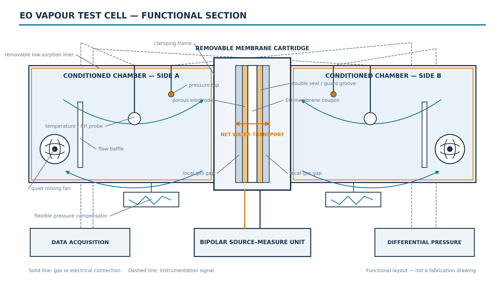

# EO vapour test cell — selected design basis

Status: engineering working basis for net-transient membrane measurements; not a fabrication-release drawing.

*Figure 1. Two-dimensional functional section showing the central membrane cartridge, symmetric conditioned chambers, sensing, internal mixing, pressure compensation, source-measure unit and acquisition connections. Values and dimensions are deliberately kept outside the figure. It is an engineering system blueprint, not released fabrication CAD.*

## Selected working values

| Quantity | Selected value | Reason |
| --- | ---: | --- |
| Active membrane window | 50 x 50 mm = 25 cm² | Largest existing aperture, strong absolute water signal and lower edge-to-area ratio. |
| Membrane coupon | 80 x 80 mm | Leaves land for the double seal, guard groove and clamping. |
| Local gas gap | 2 mm per side | Matches the local transport model and gives 5.0 mL active-gap volume per side. |
| Calibrated net gas volume | 500 ± 5 mL per side | Retains the illustrated 0.50 L cell and slows the humidity transient enough for the present instrumentation. |
| Bulk plenum | 165 x 165 x 20 mm | Produces 544.5 mL gross volume while keeping the active membrane fixed at 25 cm². |
| Polarity protocol | 12 s segments; +1, -1, -1, +1 | Reports net transferred water per segment and uses reversal to suppress fixed and linear drift. |

## Calculation basis

At 32 °C, 101.325 kPa and 50% initial RH, the conditional design flux is 208 g m⁻² h⁻¹. This is a sizing target, not a measured membrane property.

**Integrated rate**

`ṁ = J A = 208 x 0.0025 = 520 mg h⁻¹ = 0.144444 mg s⁻¹`

**Transferred mass in one segment**

`Δm = ṁ Δt = 0.144444 x 12 = 1.733333 mg`

**Ideal well-mixed humidity response**

`ΔRH = Δm / (ρ_sat V) = 10.261 percentage points per chamber`

The first positive segment therefore moves the ideal chamber endpoints from 50%/50% to 39.739%/60.261%. The chamber-to-chamber difference is 20.523 percentage points.

**Volume accounting**

`544.5 mL gross − 22.6 mL component bound = 521.9 mL pre-trim`

`521.9 mL − 21.9 mL nominal insert = 500.0 mL calibrated net gas`

The removable trim system must cover 21.9–44.5 mL because actual solid displacement is not yet measured.

## Why this working point

The 500 mL inventory prevents the response from becoming excessively fast while retaining a clear net-transient signal. A 12 s segment gives approximately 10.3 percentage points per chamber. The SHT45 step-response fraction over this duration is 95.0%; however, a continuously changing RH ramp would only be indicated at about 68.3% in a simple first-order sensor model. A faster calibrated reference remains preferable for the transient shape.

The rigid-cell gas diagnostic is 976 Pa after one segment, far above the 5 Pa differential-pressure target. Under the same ideal-gas screen, pressure management therefore needs approximately ±2.40 mL travel per side and 4.79 mL full stroke. This requirement must be verified with the real diaphragm, fan, seals and ports.

## Error-controlled construction

| Control | Selected design or acceptance criterion |
| --- | --- |
| Structural walls | 12 mm EN AW-6082-T6 aluminium; 1.33 µm pressure-only deflection at the proof screen. |
| Insulating cartridge plate | 20 mm Unfilled PEEK; 4.51 µm pressure-only deflection. |
| Loaded membrane gap | 2.00 ± 0.02 mm with hard stops and a loaded gap map. |
| Wetted surfaces | Removable smooth non-porous metal liners; exposed PEEK limited to the required insulating land. |
| Edge effects | Retain the 50 mm primary aperture and use 30, 40, 50 mm inserts to fit area and perimeter terms. A hypothetical 1 mm edge band already covers 7.84% of the active area. |
| Wall-storage blank | No more than 0.01733 mg per segment (0.256 nm equivalent reversible film). |
| Sensors and mixing | 2 T/RH positions per chamber; pair calibration ≤ 0.10 RH point and spatial disagreement ≤ 0.15 RH point. |
| State control | Chamber ΔT ≤ 0.05 K, measured volume uncertainty ≤ 1.0 mL and cross-leak screen ≤ 6.25 mL/min at peak RH difference. |

The planning root-sum-square error allocation is 3.36% of the corrected segment signal. This is not a claimed accuracy: impermeable-coupon, zero-current, leakage, mixing and aperture-scaling tests must pass before results are accepted.

## Measurement interpretation

The reported quantity is integrated **net water movement through the membrane during each segment** under evolving RH conditions. It includes EO-driven transport together with opposing diffusion and other real membrane effects. The symmetric sequence lasts 48 s and returns the ideal closed-cell inventory to its initial state after a complete block. It does not demonstrate sustained dehumidification.

The selected dimensions remain conditional on measured mixing, leakage, temperature bias, differential pressure, installed component displacement and calibrated net volume. The visualization is not fabrication evidence.
